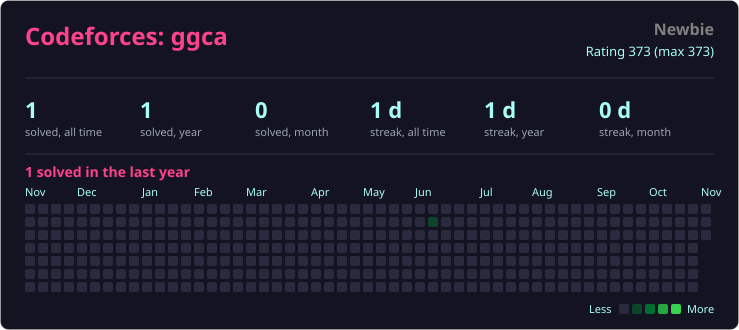

<h1 align="center">
  
</h1>

  

  
  
  

## 👋 About me

I'm a **full-stack developer** with a focus on **cybersecurity**. I build web applications from database to UI, and I make sure they're secure by design, not by accident.

- 🔐 Interested in application security, pentesting, and secure architecture
- 🌐 Learning to build web apps with security in mind
- 📚 Currently learning: computer networking, CTFs, penetration testing and web development
- 📫 Reach me: [email](mailto:cammeonn@gmail.com)

## 🛠️ Tech stack

  

## 🔒 Security focus

- Web application security (OWASP Top 10)
- Penetration testing & vulnerability research
- Secure coding practices & code review
- CTFs and hands-on labs: [TryHackMe](https://tryhackme.com/p/cammeonn), Hack The Box

## 🚀 Featured projects

  

## 📊 GitHub stats

  

## 🧩 LeetCode stats

  

## 📊 Codeforces stats

  

# 🕵️ TryHackMe

  

